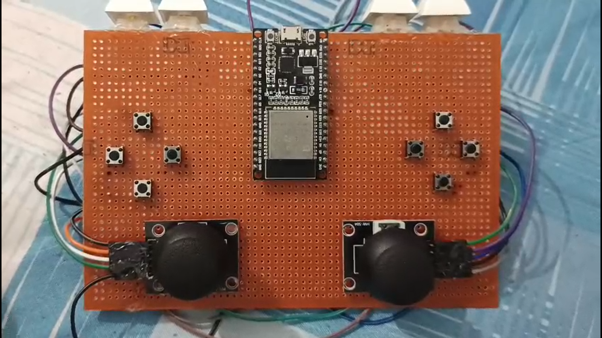

# Klik - DIY Bluetooth Game Controller

**Klik** is a custom wireless game controller built using an ESP32-WROOM-32, two analog joysticks, and 12 physical buttons. It communicates with Android devices over Bluetooth Low Energy (BLE) and uses the ESP32 BLE Gamepad library to emulate a gamepad.

---

# Features

- Bluetooth LE Connectivity — Connect wirelessly to Android devices.

- Dual Analog Joysticks — Independent left and right analog sticks.

- 12 Physical Buttons — Complete button layout inspired by modern game controllers.

- 8-Directional D-Pad — Supports diagonal directional inputs.

- Analog-Style Triggers — L2 and R2 are mapped to trigger axes.

- Joystick Clicks — L3 and R3 support.

- Joystick Calibration — Individual center calibration values for both joysticks.

- Adjustable Deadzone — Filters unwanted analog stick movement.

- 10 ms Reporting Interval — Configured gamepad report interval of 100 Hz.

---

# Hardware

| Component | Quantity |
| :--- | :---: |
| ESP32-WROOM-32 Dev Board | 1 |
| Analog Joystick Modules | 2 |
| Push Buttons | 12 |
| Jumper Wires | As required |

_No additional shift registers or button-expansion ICs are used._

---

# Wiring

## Left Joystick

| Pin | GPIO |
| :--- | :---: |
| VRx | 34 |
| VRy | 35 |
| SW | 18 |
| 5v | 3v3 |
| GND | GND |

## Right Joystick

| Pin | GPIO |
| :--- | :---: |
| VRx | 32 |
| VRy | 33 |
| SW | 19 |
| 5v | 3v3 |
| GND | GND |

## D-Pad

| Button | GPIO |
| :--- | :---: |
| Up | 12 |
| Down | 13 |
| Left | 14 |
| Right | 27 |

## Face Buttons

| Button | GPIO |
| :--- | :---: |
| A | 26 |
| B | 25 |
| X | 21 |
| Y | 16 |

## Shoulder Buttons

| Button | GPIO |
| :--- | :---: |
| L1 | 23 |
| L2 | 22 |
| R1 | 4 |
| R2 | 5 |

---

# Library

Install the ESP32 BLE Gamepad library:

https://github.com/lemmingDev/ESP32-BLE-Gamepad

---

# Getting Started

1. Clone or download this repository.

2. Install Arduino IDE and the ESP32 board package.

3. Install the ESP32 BLE Gamepad library.

4. Open KLIK.ino in Arduino IDE.

5. Select ESP32 Dev Module.

6. Connect your ESP32 using USB.

7. Upload the firmware.

8. Enable Bluetooth on your Android device.

9. Search for KLIK Gamepad.

10. Pair and start playing!

---

# Prototype

